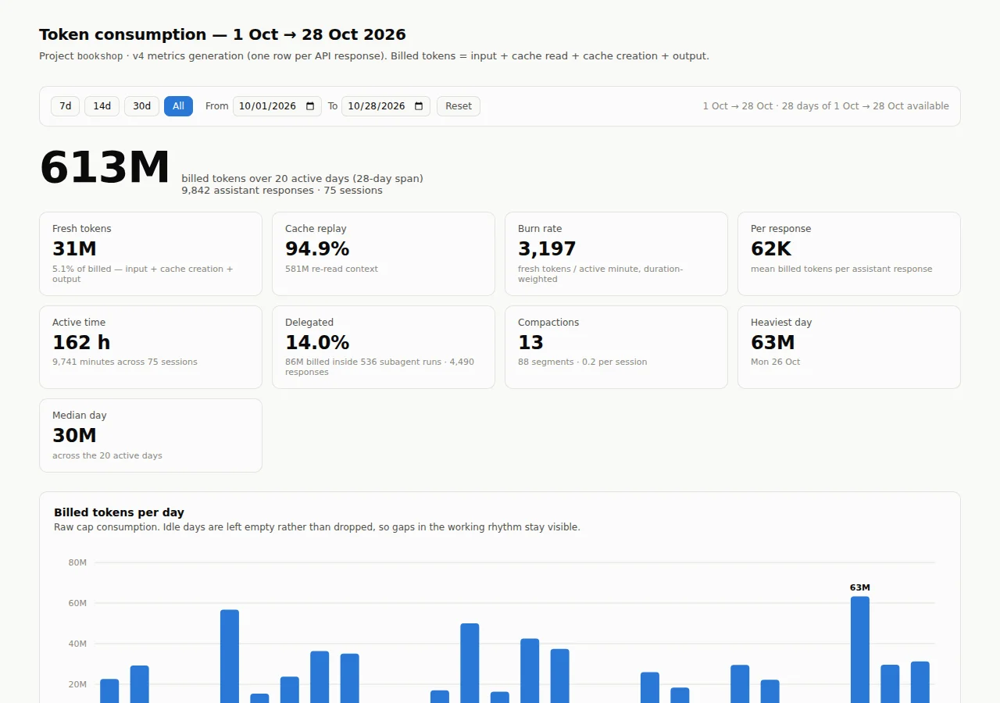
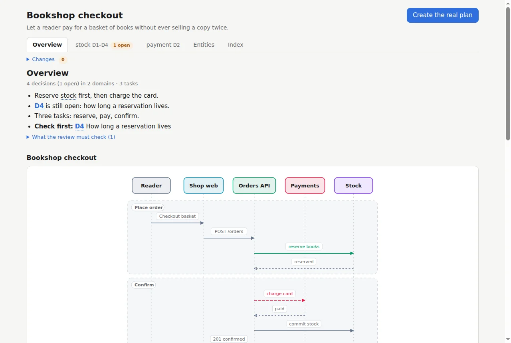

<p align="center">
  
</p>
<h1 align="center">
  <picture>
    <source media="(prefers-color-scheme: dark)" srcset=".github/assets/wordmark-dark.svg">
    
  </picture>
</h1>

<p align="center">
  
  
  <a href="LICENSE"></a>
</p>

<p align="center">
  Claude Code plugins from the workshop: session handoffs, token metrics, live plan co-design, offline diagrams and behaviour-driven scenario matrices.
</p>

<p align="center">
  <a href="#install">Install</a> · <a href="#pick-by-problem">Pick by problem</a> · <a href="#plugins">Plugins</a> · <a href="#requirements-and-scope">Requirements</a> · <a href="CONTRIBUTING.md">Contributing</a>
</p>

## Install

In Claude Code:

```
/plugin marketplace add lucaOR/officina-claude
/plugin install session@officina-claude
```

Install the other plugins the same way, with their own name before `@officina-claude`.

<details>
<summary>Offer the plugins to everyone who opens a project</summary>

To have a project offer the plugins to everyone who opens it, commit this to the
project's `.claude/settings.json`:

```json
{
  "extraKnownMarketplaces": {
    "officina-claude": {
      "source": { "source": "github", "repo": "lucaOR/officina-claude" }
    }
  },
  "enabledPlugins": {
    "session@officina-claude": true,
    "token-hygiene@officina-claude": true,
    "planner-companion@officina-claude": true,
    "diagrams@officina-claude": true,
    "scenario-matrix@officina-claude": true,
    "knowledge@officina-claude": true
  }
}
```

</details>

Plugin skills are namespaced by plugin: type `/session:handoff`, not
`/handoff`. The bare name does not resolve.

## Pick by problem

| Problem | Plugin |
|---|---|
| `/compact` summaries lose the thread, or a new session starts cold | [`session`](#session) (`/session:handoff`) |
| A vague idea needs pinning down before anyone writes code | [`session`](#session) (`/session:refine`) |
| You can't tell which sessions or habits burn your token budget | [`token-hygiene`](#token-hygiene) |
| A plan drifts from what you meant, and reviewing it in the terminal is slow | [`planner-companion`](#planner-companion) |
| You want a sequence, workflow or ER diagram without Mermaid, a browser or network | [`diagrams`](#diagrams) |
| Behaviour regressions slip through because nobody lists the scenarios | [`scenario-matrix`](#scenario-matrix) |
| Claude forgets the project's conventions and repeats mistakes it was already corrected on | [`knowledge`](#knowledge) (`/knowledge:kb`) |

## Plugins

The examples below come from one demo project, a small bookshop's checkout. The screenshots and
diagrams are real plugin output, and so is the knowledge digest line. The handoff note, the
scenario row and the knowledge rule are written by hand, in the formats the plugins use.

### `session`

`/session:handoff` writes the session's state to a note under `~/.claude/handoff/` and prints a
one-line pointer to that note. You run `/clear` and paste the pointer, so the next session
starts from the note instead of from a `/compact` summary and the conversation it retains.
`/session:refine` interviews you about a vague idea before any of that, one question per
message, until the idea becomes an intent draft with a purpose, done-criteria and non-goals.
Once you commit that draft as `.claude/intents/<slug>.md`, each handoff note quotes its goal
verbatim, and the pivot gate checks each new note against it.

- `/session:handoff`: write the note and print the pointer. `boundary` or `mid` forces the
  mode, which is a result summary for a finished task and a working-state snapshot for an
  unfinished one.
- `/session:refine`: interview a vague idea into an intent draft at
  `~/.claude/refine/<slug>/draft.md`. `/session:refine resume <slug>` picks one up again.
- Hooks, which need no command: the pivot gate judges each note against its intent file in the
  background and reports the verdict at the next session start; the new session inherits the
  `/rename` title of the session it continues; and a sweep at session start deletes a note once
  it was read more than a day ago.

<picture>
  <source media="(prefers-color-scheme: dark)" srcset=".github/assets/handoff-loop-dark.svg">
  
</picture>

A boundary note from the demo. The first line is the pointer that you paste after `/clear`,
and the rest is the note it points to:

```
read /home/you/.claude/handoff/8c41f0d2-7a3e-4b19-9e65-1f2a0c7d3b58.md — HANDOFF v1 mode=boundary parent=8c41f0d2-7a3e-4b19-9e65-1f2a0c7d3b58

HANDOFF v1 mode=boundary parent=8c41f0d2-7a3e-4b19-9e65-1f2a0c7d3b58 depth=2 budget=38/120 intent=stock-reservation@3e9a7c21
goal: "A reader can never buy a copy that is already sold. Done when two readers who check out the last copy at once get one order and one sold-out message."
shipped: the reservation step in orders/checkout.ts:88 and its release on a declined card at orders/checkout.ts:131; checkout tests pass
owed: no commit yet; no test covers two readers checking out the last copy at once
next: write the two-readers test, then commit the reservation work with it
branch: feat/stock-reservation
transcript: /home/you/.claude/projects/-demo-bookshop/8c41f0d2-7a3e-4b19-9e65-1f2a0c7d3b58.jsonl
```

### `token-hygiene`

A `SessionEnd` hook records each session's token use, subagents included, in CSV files under
`~/.claude/metrics/`. `/token-hygiene:token-dashboard` turns those files into a local HTML
dashboard with billed tokens per day, the burn rate, cache behaviour and the split by activity
class. Claude then writes a short reading of the trend, which names what drives the burn and
the lever that would cut it.

- `/token-hygiene:token-dashboard`: build `docs/token-dashboard-v4.html` and read the trend. Ask
  for the file alone and Claude skips the commentary.
- The `SessionEnd` hook needs no command. Enable the plugin per project, as
  [Requirements and scope](#requirements-and-scope) explains.

<picture>
  <source media="(prefers-color-scheme: dark)" srcset=".github/assets/dashboard-dark.webp">
  
</picture>

### `planner-companion`

`/planner-companion:plan` co-designs a plan with you on a live local web page, so you review it
there rather than in the terminal. After an interview in the terminal, Claude puts each decision
that changes what gets built on the page as a card with two or three options, a recommended pick
and what each option trades off. On the page you pick options, comment, request changes and undo
them, and a background watcher wakes the session to answer each one. When the plan is done,
the page's "Create the real plan" button writes it out as a `plan.md`.

- `/planner-companion:plan <what to plan>`: interview, then open the plan page and fill it.
- `/planner-companion:plan reopen <plan-folder>`: restart the page for an unfinished review. A
  `SessionStart` hook prints this line for every review left unfinished.

<picture>
  <source media="(prefers-color-scheme: dark)" srcset=".github/assets/plan-dark.webp">
  
</picture>

### `diagrams`

`/diagrams:diagram` draws a sequence diagram, a workflow or an entity-relationship diagram from
a few compact JSON rows. The renderer is plain Node with no dependencies, so it needs no
Mermaid, no browser and no network. It writes a standalone HTML page that follows the system's
light or dark theme, or an SVG file that carries its own styles. `planner-companion` draws its
plan diagrams with the same renderer.

- `/diagrams:diagram`: describe the diagram you want. Claude also uses the skill on its own when
  you ask for one of these three kinds of diagram.

<picture>
  <source media="(prefers-color-scheme: dark)" srcset=".github/assets/checkout-sequence-dark.svg">
  
</picture>

<picture>
  <source media="(prefers-color-scheme: dark)" srcset=".github/assets/catalogue-erd-dark.svg">
  
</picture>

### `scenario-matrix`

`scenario-matrix` keeps a behaviour-driven test matrix for each epic in
`.claude/scenarios/<epic>.yaml`. Each row is one observable behaviour, and its `expected` comes
from the epic's intent, never from what the code does today. `/scenario-matrix:setup` installs a
Node harness sized to the project's stack, with adapters for a browser, HTTP, SQL databases,
Docker and more. `/scenario-matrix:matrix` compiles each row into an executable script, and
`/scenario-matrix:run` runs the scripts and writes a report of the bugs it found.

- `/scenario-matrix:setup`: detect the stack, propose the adapters and install them once you
  confirm. `--upgrade` refreshes the plugin-owned files, and `--add <adapter>` adds one more.
- `/scenario-matrix:matrix <epic> build | add "<behaviour>" | compile`: derive the matrix from
  the epic's intent, add one row, or compile rows into scripts.
- `/scenario-matrix:run <epic> [<id> | <family>]`: run one scenario, a family or the whole
  matrix. `--plan` lists which scripts are fresh, stale or uncompiled.

A row in `.claude/scenarios/checkout.yaml`, as the run left it:

```yaml
  - id: C-02
    behaviour: "two readers buy the last copy at once: one order, one sold-out message"
    reach: wiring
    priority: P1
    setup:
      - db: {target: scn_shop, sql: "UPDATE stock SET copies = 1 WHERE book_id = 42"}
    steps:
      - action: "POST /orders for book 42 as two customers at the same moment"
    expected: "one 201 and one 409 sold_out; the stock row for book 42 ends with copies = 0"
    status: drift
    last_run: "2026-11-20 KO"
    bug_ref: BUG-1
    script: _scripts/checkout/C-02.mjs
    compiled_from: 4b7e19c0a2d3
    compiled: "verified 2026-11-18"
```

The start of that run's report:

```markdown
# checkout run 2026-11-20
Suite: 3 scenarios — compiled 3/3 — 2 OK · 1 KO
Ran `run.mjs checkout` -> provisioned -> ran suite -> torn down
(the config's `lifecycle.down` command). Ambient dev stack restored.

| id   | behaviour                        | result | runtime | why |
|------|----------------------------------|--------|---------|-----|
| C-01 | books reserved before the charge | OK     | 2.4s    |     |
| C-02 | last copy, two readers at once   | KO     | 3.1s    | expected one 409, got two 201s (copies went to -1) |
| C-03 | declined card releases the stock | OK     | 2.7s    |     |

## Bugs found

### BUG-1 · the last copy can be sold twice
```

### `knowledge`

`knowledge` keeps a project's knowledge base as atomic YAML rules in `.claude/knowledge/`, and it
puts the right rule in front of Claude at the right moment. A digest of every rule is injected at
session start. Before Claude edits a file, the bodies of the rules that match it are injected,
and after the edit the rules' `check:` commands run on the file. Any session pushes what it
learns into a queue with `/knowledge:kb`, and a separate scribe session turns the queue into a
plan of rules that you accept or reject one by one. `/knowledge:setup` seeds the base from
Claude memory and from instruction files such as `CLAUDE.md`.

- `/knowledge:setup`: seed the base, then choose the scribe's commit setting, the registration
  for teammates, the git gate and the `ccscribe` shortcut. It is safe to re-run.
- `/knowledge:kb <fact and what backs it>`: push an observation into the queue. In a scribe
  session, started with `claude --agent knowledge:scribe`, `/knowledge:kb run` drains the queue.
- Hooks, which need no command: the digest at session start, rule injection before an edit and
  the checks after it. Each hook stays silent in a project that has no `.claude/knowledge/`.

The [plugin's README](plugins/knowledge/README.md) covers setup, the scribe and the rule schema in
full. A rule in the demo's `.claude/knowledge/checkout.yaml`:

```yaml
scope: project
topic: checkout
rules:
  - id: reserve-before-charge
    title: Reserve the copies before the card is charged
    applies_to:
      globs: ["orders/**/*.ts"]
    severity: blocking
    resident: true
    trigger: changing the order flow
    rule: Reserve every copy before the charge, and release the copies if the card is declined.
    rationale: Charging first let two readers pay for the last copy at once.
    source: "orders/checkout.ts:88, 2026-11-20"
```

The line it gets in the digest that every session starts with:

```markdown
## checkout
- [blocking] reserve-before-charge — Reserve every copy before the charge, and release the copies if the card is declined. · when: changing the order flow
```

## Requirements and scope

- `python3` for the hooks and scripts of `session`, `token-hygiene`, `planner-companion` and `knowledge`, and `node` for `token-hygiene`, `planner-companion` and `diagrams`. `scenario-matrix` needs no `python3`.
- `scenario-matrix` needs `node` 20 or later and `npm` in the target project; the `browser` adapter downloads Chromium.
- `planner-companion` needs Claude Code 2.1.328 or later. Its page wakes the session through a background
  `Bash` watcher, which was proven on that version and is untested on older ones.
- The refine reviewer and the pivot gate shell out to `claude -p`, so the CLI must be on `PATH`.
- Enable `token-hygiene` per project, not at user scope. Its CSVs under `~/.claude/metrics/`
  carry no project column, so a user-scope install mixes every project into one dataset.
- Per-project state stays in the project: intent files in `.claude/intents/`, paired-role
  notes in `.claude/handoff.local*.md`, the dashboard in `docs/`, and the knowledge base in
  `.claude/knowledge/`, with its per-machine queue and ledger in the gitignored
  `.claude/knowledge/.local/`. Each session hook acts only on its own trigger (a handoff note
  written or read), so it stays quiet in a project that never writes one.

---

Released under the [MIT licence](LICENSE). To work on the plugins themselves, see
[CONTRIBUTING.md](CONTRIBUTING.md).
